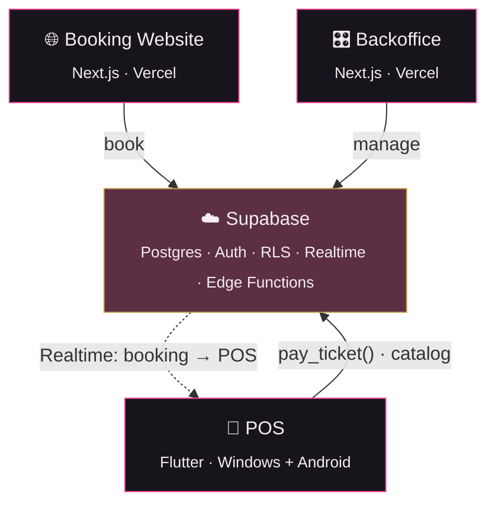

<p align="center">
  
</p>

<p align="center">
  
  
  
  
</p>

<p align="center">
  <b>The platform backend + web apps for Rosea, a beauty salon.</b><br>
  <sub>Online booking · in-salon POS · owner backoffice — on one Supabase backend.</sub>
</p>

<p align="center">
  <a href="docs/ROADMAP.md">Roadmap</a> ·
  <a href="docs/2026-10-30-foundation-stage1-design.md">Design spec</a> ·
  <a href="docs/2026-10-30-foundation-stage1-plan.md">Build plan</a> ·
  <a href="CLAUDE.md">Rulebook</a> ·
  <a href="https://github.com/GaryCharbel/rosea-pos">POS app ↗</a>
</p>

---

## ✦ What is this

**Rosea** lets a salon take bookings online, ring up and get paid at the counter, and manage everything from one dashboard — with **every service credited to the stylist who performed it**, and commissions that work themselves out.

This repo is the **platform**: the Supabase backend (database, auth, security, the commission engine) and the **web** apps. The desktop/mobile **POS** lives in its own repo → [**`rosea-pos`**](https://github.com/GaryCharbel/rosea-pos).



## 🧱 Repository layout

```
rosea/
├─ supabase/            # BE + infra — migrations, RLS, pay_ticket & edge fns, seed, config
│  ├─ migrations/       # versioned SQL (helpers + enums in migration #1)
│  ├─ tests/            # pgTAP
│  ├─ seeds/            # demo salon
│  └─ config.toml
├─ web/                 # Next.js — booking site + backoffice (Stage 2–3)
├─ docs/                # spec · plan · roadmap · runbook · release
├─ .github/workflows/   # CI (path-filtered)
└─ CLAUDE.md            # the rulebook (golden rules)
```

## 🔑 The commission contract (the heart of it)

| Rule | How |
|------|-----|
| **Performer per line** | each `ticket_line` is credited to `performer_staff_id` (`staff.id`) |
| **Rate × post-discount** | commission = `round(base × rate / 100, 2)` on the amount actually paid |
| **Rate per staff** | services use `staff.commission_rate`; products earn only if `commission_eligible` + a `staff.product_commission_rate` |
| **Only on paid tickets** | written by `pay_ticket()` — a single atomic, idempotent Postgres RPC |
| **Money tables are RPC-write-only** | `payment` / `tip` / `commission_entry` / `stock_movement` reject direct writes |

## 🚀 Getting started (local)

> Requires **Docker** (for the local Supabase stack) and **Node**. The Supabase CLI is pinned as a dev dependency — no global install.

```bash
npm install                 # installs the pinned Supabase CLI
npx supabase start          # boots Postgres + Auth + Studio locally
npx supabase db reset       # applies migrations + seeds the demo salon
npx supabase test db        # runs the pgTAP suite
```

Full setup, env, and deploy steps: [`docs/runbook.md`](docs/runbook.md) · release flow: [`docs/release.md`](docs/release.md).

## 🧭 Roadmap

**Stage 1** POS core + commissions *(current)* → **Stage 2** booking website + live sync → **Stage 3** backoffice + offers → **Stage 4** loyalty, gift cards & memberships. Details → [`docs/ROADMAP.md`](docs/ROADMAP.md).

## 📏 Ground rules

Never commit to `main` · nothing merges without a thorough review · CI (build + full tests) gates every PR · security & data confidentiality first-class · **correctness → reliability → speed → features** · zero N+1. Full set → [`CLAUDE.md`](CLAUDE.md).

<sub>Built by <b>Gary Charbel El Hadchity</b>.</sub>
